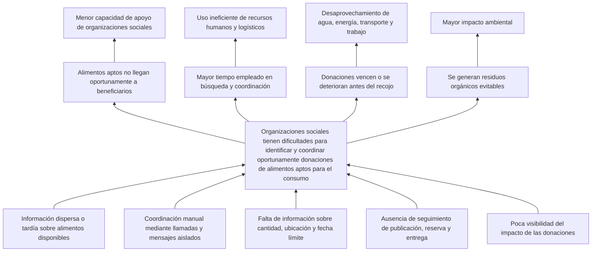
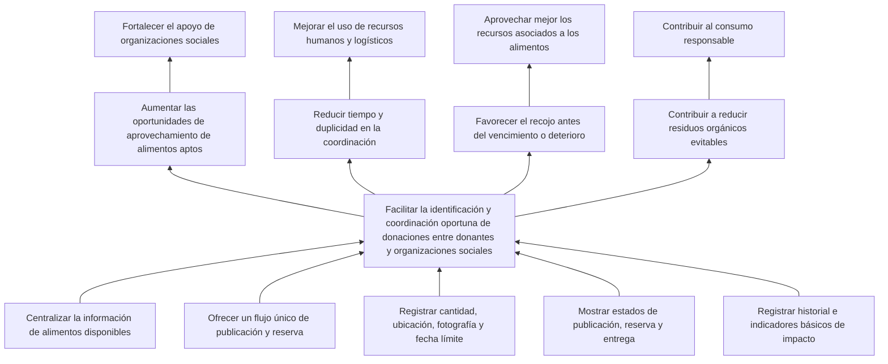

# Fase 2: Árbol de problemas y objetivos

## Resultado de la fase

AlimentoRed buscará mejorar la coordinación oportuna de donaciones de alimentos entre donantes y organizaciones sociales mediante información centralizada, reservas sin duplicidad, seguimiento de estados y registro del impacto. El proyecto no pretende resolver toda la inseguridad alimentaria ni reemplazar la evaluación sanitaria o la logística física.

## 1. Árbol de problemas

El árbol organiza el diagnóstico de la Fase 1 en tres niveles: las causas originan el problema central y este produce efectos directos e indirectos.

### Lectura resumida

| Nivel | Elementos principales |
|---|---|
| Causas | Información fragmentada, coordinación manual, datos incompletos, falta de seguimiento y escasa medición del impacto |
| Problema central | Dificultad para identificar y coordinar oportunamente donaciones disponibles |
| Efectos | Entregas perdidas o tardías, más trabajo operativo, deterioro de alimentos y residuos evitables |
| Impactos | Menor apoyo social, uso ineficiente de recursos y consecuencias ambientales |

## 2. Árbol de objetivos

El árbol de objetivos transforma cada situación negativa en una condición positiva alcanzable por el proyecto.

### Correspondencia entre problemas y objetivos

| Situación negativa | Condición buscada |
|---|---|
| Información dispersa | Información centralizada y consultable |
| Coordinación manual aislada | Flujo común de publicación y reserva |
| Datos incompletos | Publicaciones con información mínima obligatoria |
| Desconocimiento del estado | Estados visibles y actualizados |
| Impacto no registrado | Historial e indicadores básicos |
| Donaciones duplicadas o tardías | Reserva única y coordinación oportuna |

## 3. Objetivo general

Desarrollar un producto mínimo viable multiplataforma para Android y web que facilite la publicación, consulta, reserva y seguimiento de donaciones de alimentos aptos para el consumo entre donantes y organizaciones sociales, tomando Lima Metropolitana como contexto inicial de validación.

## 4. Objetivos específicos

### OE-01. Centralizar la oferta de donaciones

Implementar un módulo que permita a un donante registrar, consultar y actualizar publicaciones con fotografía, categoría, cantidad, ubicación, fecha límite y condiciones de recojo.

**Indicador de cumplimiento:** el sistema guarda y muestra todos los datos obligatorios de una publicación válida.

### OE-02. Facilitar la consulta de alimentos disponibles

Implementar un listado que permita a las organizaciones sociales consultar donaciones vigentes y encontrar opciones mediante criterios básicos de categoría, ubicación o disponibilidad.

**Indicador de cumplimiento:** una organización puede identificar y abrir el detalle de una donación disponible utilizando al menos un filtro.

### OE-03. Evitar reservas duplicadas

Implementar un proceso de reserva que asigne una donación disponible a una sola organización y actualice su estado para los demás usuarios.

**Indicador de cumplimiento:** una donación reservada no puede ser reservada simultáneamente por otra organización.

### OE-04. Dar seguimiento al proceso

Representar el ciclo de una donación mediante estados controlados: disponible, reservada, entregada, cancelada o vencida.

**Indicador de cumplimiento:** cada cambio válido queda reflejado en la publicación y en el historial de los participantes.

### OE-05. Visibilizar el impacto básico

Registrar las donaciones entregadas y presentar indicadores comprensibles, como número de entregas completadas y cantidad total declarada de alimentos recuperados.

**Indicador de cumplimiento:** el sistema calcula los indicadores exclusivamente a partir de donaciones marcadas como entregadas.

### OE-06. Validar la experiencia multiplataforma

Construir interfaces adaptables y verificar el flujo principal en Android y navegador web.

**Indicador de cumplimiento:** registro, publicación, consulta, reserva y entrega pueden demostrarse en ambas plataformas sin errores bloqueantes.

## 5. Alcance funcional del MVP

### Incluido

- Registro e inicio de sesión.
- Selección de rol: donante u organización social.
- Perfil básico de usuario y organización.
- Creación, edición y cancelación de publicaciones.
- Fotografía y datos obligatorios del alimento.
- Dirección o referencia para el recojo.
- Listado, filtros básicos y detalle de donaciones.
- Reserva única de una donación disponible.
- Cambios controlados de estado.
- Historial por usuario.
- Indicadores básicos de donaciones entregadas.
- Funcionamiento demostrable en Android y web.

### Condicionado al tiempo disponible

- Uso de la ubicación actual del dispositivo.
- Visualización de una ubicación mediante mapa.
- Notificaciones locales sobre cambios de estado.
- Recuperación de contraseña mediante correo.

Estas capacidades solo se implementarán después de completar y probar el flujo principal.

### Excluido

- Pagos, ventas o comisiones.
- Chat en tiempo real.
- Seguimiento GPS continuo del transporte.
- Optimización automática de rutas.
- Gestión de flotas o almacenes.
- Evaluación o certificación sanitaria automática.
- Verificación gubernamental de identidades.
- Predicción de demanda mediante inteligencia artificial.
- Operación logística nacional real.
- Garantía de entrega física o calidad del alimento.

## 6. Límites y responsabilidades

| Actor | Responsabilidad dentro del MVP |
|---|---|
| Donante | Declarar información correcta, publicar alimentos aptos y mantener actualizado su estado |
| Organización social | Revisar la información, reservar responsablemente y coordinar el recojo |
| Aplicación | Facilitar información, reserva, estados e historial |
| Fuera del sistema | Inspección sanitaria, transporte, conservación y entrega física |

La aplicación deberá mostrar que la información del alimento es declarada por el donante. No podrá presentar una publicación como certificada sanitariamente si no existe un proceso real que lo respalde.

## 7. Trazabilidad inicial

| Causa o necesidad | Objetivo | Capacidad prevista |
|---|---|---|
| Información dispersa | OE-01 | Publicación centralizada |
| Datos insuficientes | OE-01 | Campos obligatorios y fotografía |
| Dificultad para encontrar alimentos | OE-02 | Listado, filtros y detalle |
| Coordinación duplicada | OE-03 | Reserva única |
| Falta de seguimiento | OE-04 | Estados e historial |
| Impacto poco visible | OE-05 | Indicadores de entregas |
| Requisito multiplataforma | OE-06 | Android y web con Flutter |

Esta tabla será ampliada en la Fase 3 con los identificadores de requisitos funcionales y no funcionales.

## 8. Criterios de aceptación de la fase

- [x] El árbol diferencia causas, problema central y efectos.
- [x] El árbol de objetivos transforma situaciones negativas en condiciones alcanzables.
- [x] El objetivo general expresa producto, usuarios, propósito y contexto.
- [x] Los objetivos específicos incluyen indicadores verificables.
- [x] El alcance distingue funcionalidades incluidas, condicionadas y excluidas.
- [x] Cada capacidad principal responde a una causa o necesidad documentada.
- [x] La solución reconoce sus límites sanitarios y logísticos.

## Siguiente fase

Convertir los objetivos y capacidades aprobados en requisitos funcionales, requisitos no funcionales, reglas de negocio y criterios de aceptación verificables.
