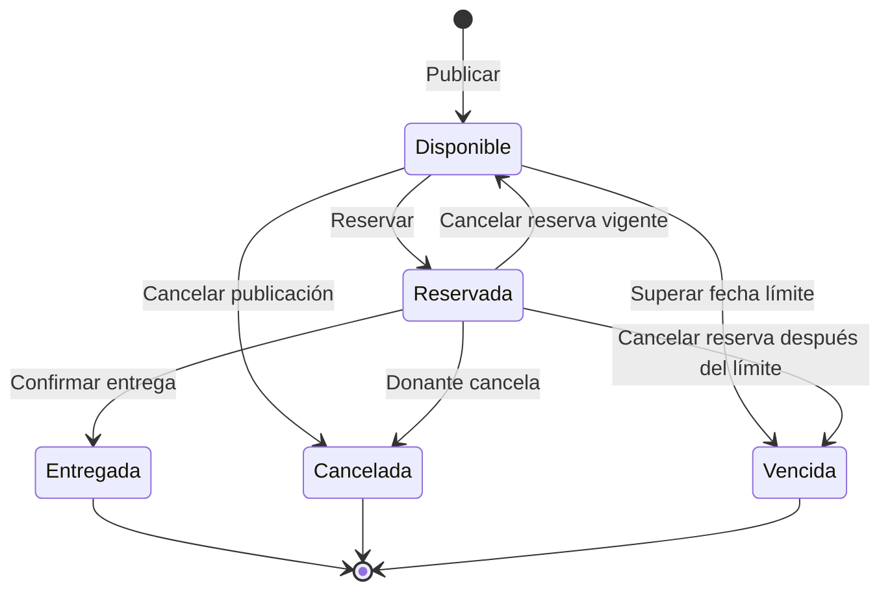

# Fase 3: Requisitos del sistema

## Resultado de la fase

Esta especificación define qué debe hacer AlimentoRed, bajo qué condiciones debe funcionar y qué reglas controlarán las donaciones. Los requisitos corresponden exclusivamente al MVP para Android y web y serán la base de las historias de usuario, interfaces, arquitectura y pruebas.

## 1. Convenciones

| Prefijo | Significado |
|---|---|
| ACT | Actor del sistema |
| RF | Requisito funcional |
| RNF | Requisito no funcional |
| RN | Regla de negocio |
| CA | Criterio de aceptación |
| P1 | Prioridad obligatoria para el MVP |
| P2 | Prioridad importante, implementada después del flujo principal |
| P3 | Mejora futura fuera del MVP |

Los verbos **debe** y **no debe** expresan una condición obligatoria. Cada requisito tendrá un identificador único para conservar su trazabilidad durante el desarrollo.

## 2. Actores y roles

### ACT-01. Visitante

Persona que todavía no inició sesión.

**Puede:**

- Consultar la presentación general de AlimentoRed.
- Registrarse.
- Iniciar sesión.

**No puede:** publicar, reservar ni modificar donaciones.

### ACT-02. Donante

Persona o representante de un comercio, restaurante, mercado o productor que ofrece alimentos aptos para el consumo.

**Puede:**

- Gestionar su perfil.
- Crear y administrar sus publicaciones.
- Consultar reservas recibidas.
- Confirmar la entrega de una donación.
- Consultar su historial e indicadores.

### ACT-03. Organización social

Representante de un comedor popular, olla común, albergue u otra organización que recibe alimentos para atender población vulnerable.

**Puede:**

- Gestionar el perfil de su organización.
- Consultar y filtrar donaciones disponibles.
- Reservar una donación.
- Cancelar una reserva antes de la entrega.
- Consultar su historial e indicadores.

### Servicios externos previstos

No son usuarios, pero colaborarán técnicamente con el sistema:

- Servicio de autenticación y persistencia.
- Almacenamiento de imágenes.
- Servicios del dispositivo para cámara y ubicación, si se implementan capacidades P2.

## 3. Requisitos funcionales

### Acceso y perfiles

#### RF-01. Registrar una cuenta — P1

El sistema debe permitir el registro mediante nombre, correo electrónico, contraseña, teléfono y rol.

**Criterios de aceptación:**

- CA-01.1: todos los campos obligatorios son validados antes del envío.
- CA-01.2: el correo debe tener un formato válido.
- CA-01.3: no se permite registrar dos cuentas con el mismo correo.
- CA-01.4: el rol solo puede ser donante u organización social.
- CA-01.5: al completarse el registro, el usuario puede acceder al flujo correspondiente a su rol.

#### RF-02. Iniciar y cerrar sesión — P1

El sistema debe permitir que una cuenta registrada inicie y cierre sesión.

**Criterios de aceptación:**

- CA-02.1: las credenciales válidas permiten ingresar.
- CA-02.2: las credenciales inválidas generan un mensaje comprensible sin revelar datos sensibles.
- CA-02.3: al cerrar sesión se impide el acceso a funciones protegidas.

#### RF-03. Gestionar el perfil — P1

El sistema debe permitir consultar y actualizar la información básica del perfil.

**Criterios de aceptación:**

- CA-03.1: el donante puede actualizar nombre, teléfono y datos descriptivos.
- CA-03.2: la organización puede actualizar nombre, tipo, responsable, teléfono, dirección y descripción.
- CA-03.3: los campos obligatorios no pueden guardarse vacíos.
- CA-03.4: el rol de la cuenta no puede cambiarse desde la edición del perfil.

### Publicación de donaciones

#### RF-04. Crear una publicación — P1

El sistema debe permitir que un donante publique alimentos disponibles.

**Datos obligatorios:** título, categoría, descripción, cantidad, unidad de medida, fecha límite de recojo, dirección o referencia y al menos una imagen.

**Criterios de aceptación:**

- CA-04.1: únicamente una cuenta donante puede crear publicaciones.
- CA-04.2: cantidad debe ser mayor que cero.
- CA-04.3: la fecha límite debe ser posterior al momento de publicación.
- CA-04.4: la publicación válida se crea con estado `disponible`.
- CA-04.5: si ocurre un error, el sistema informa la causa y no crea registros incompletos.

#### RF-05. Consultar publicaciones propias — P1

El sistema debe mostrar al donante sus publicaciones activas e históricas.

**Criterios de aceptación:**

- CA-05.1: se distinguen publicaciones disponibles, reservadas, entregadas, canceladas y vencidas.
- CA-05.2: cada elemento permite abrir su detalle.
- CA-05.3: una cuenta no puede administrar publicaciones de otro donante.

#### RF-06. Editar una publicación — P1

El sistema debe permitir editar una publicación mientras esté disponible.

**Criterios de aceptación:**

- CA-06.1: se aplican las mismas validaciones de RF-04.
- CA-06.2: una publicación reservada, entregada, cancelada o vencida no puede modificar sus datos esenciales.
- CA-06.3: los cambios guardados se muestran al volver al detalle.

#### RF-07. Cancelar una publicación — P1

El sistema debe permitir al donante cancelar una publicación que todavía no fue entregada.

**Criterios de aceptación:**

- CA-07.1: se solicita confirmación antes de cancelar.
- CA-07.2: una publicación entregada no puede cancelarse.
- CA-07.3: si existe una reserva activa, la organización debe visualizar que fue cancelada.
- CA-07.4: la publicación permanece en el historial con estado `cancelada`.

### Consulta y búsqueda

#### RF-08. Listar donaciones disponibles — P1

El sistema debe mostrar a la organización social las donaciones disponibles y vigentes.

**Criterios de aceptación:**

- CA-08.1: el listado no muestra como disponibles publicaciones reservadas, entregadas, canceladas o vencidas.
- CA-08.2: cada elemento resume título, categoría, cantidad, ubicación referencial y fecha límite.
- CA-08.3: el listado informa cuando no existen resultados.

#### RF-09. Filtrar donaciones — P1

El sistema debe permitir filtrar las donaciones por texto, categoría y zona o distrito declarado.

**Criterios de aceptación:**

- CA-09.1: cada filtro puede aplicarse por separado.
- CA-09.2: los filtros pueden combinarse.
- CA-09.3: se puede limpiar la búsqueda y recuperar el listado completo.

#### RF-10. Consultar el detalle — P1

El sistema debe mostrar la información completa de una donación seleccionada.

**Criterios de aceptación:**

- CA-10.1: se muestran imagen, descripción, cantidad, fecha límite, ubicación, condiciones y estado actual.
- CA-10.2: se identifica al donante mediante la información pública definida para el perfil.
- CA-10.3: la acción de reservar solo aparece cuando la publicación está disponible y vigente.

### Reserva y entrega

#### RF-11. Reservar una donación — P1

El sistema debe permitir que una organización social reserve una donación disponible.

**Criterios de aceptación:**

- CA-11.1: únicamente una organización social puede reservar.
- CA-11.2: una publicación admite como máximo una reserva activa.
- CA-11.3: al reservar, la publicación cambia a estado `reservada`.
- CA-11.4: si otra organización se adelantó, se informa que la donación ya no está disponible.
- CA-11.5: la reserva aparece en los historiales del donante y de la organización.

#### RF-12. Cancelar una reserva — P1

El sistema debe permitir que la organización cancele una reserva antes de la entrega.

**Criterios de aceptación:**

- CA-12.1: se solicita confirmación.
- CA-12.2: al cancelar una reserva vigente, la donación vuelve a `disponible` si su fecha límite no venció.
- CA-12.3: si la fecha límite ya venció, la donación pasa a `vencida`.
- CA-12.4: una donación entregada no permite cancelar la reserva.

#### RF-13. Confirmar la entrega — P1

El sistema debe permitir al donante confirmar que una donación reservada fue entregada.

**Criterios de aceptación:**

- CA-13.1: solo el propietario de la publicación puede confirmar la entrega.
- CA-13.2: únicamente una donación reservada puede pasar a `entregada`.
- CA-13.3: la confirmación requiere una advertencia previa porque no se puede revertir desde el MVP.
- CA-13.4: la entrega actualiza los historiales e indicadores de ambos participantes.

### Historial e impacto

#### RF-14. Consultar el historial — P1

El sistema debe mostrar las publicaciones o reservas relacionadas con la cuenta autenticada.

**Criterios de aceptación:**

- CA-14.1: el donante consulta sus publicaciones y sus estados.
- CA-14.2: la organización consulta sus reservas y sus estados.
- CA-14.3: el historial se ordena desde la actividad más reciente.

#### RF-15. Consultar indicadores — P1

El sistema debe presentar indicadores básicos calculados desde donaciones entregadas.

**Criterios de aceptación:**

- CA-15.1: se muestra el número total de donaciones entregadas relacionadas con la cuenta.
- CA-15.2: se agrupan cantidades por unidad de medida para no sumar unidades incompatibles.
- CA-15.3: publicaciones no entregadas no incrementan los indicadores.

### Capacidades condicionadas

#### RF-16. Usar la ubicación actual — P2

El sistema podrá permitir que el donante complete su ubicación con los servicios del dispositivo, siempre solicitando permiso previamente y permitiendo el ingreso manual como alternativa.

#### RF-17. Tomar o seleccionar una fotografía — P2

El sistema podrá permitir obtener la imagen desde la cámara o galería, sujeto a los permisos y capacidades de cada plataforma.

#### RF-18. Mostrar notificaciones locales — P2

El sistema podrá avisar localmente sobre cambios relevantes de estado sin requerir mensajería en tiempo real.

## 4. Requisitos no funcionales

### RNF-01. Compatibilidad multiplataforma — P1

La aplicación debe ejecutar el flujo principal en Android y en navegadores web modernos a partir de una única base de código Flutter.

**Verificación:** demostración completa en un dispositivo o emulador Android y en un navegador de escritorio.

### RNF-02. Diseño adaptable — P1

Las interfaces deben adaptarse al ancho disponible sin desbordamientos, controles inaccesibles ni texto cortado.

**Verificación:** pruebas en vista móvil y escritorio en las pantallas principales.

### RNF-03. Facilidad de uso — P1

Las acciones principales deben utilizar etiquetas comprensibles, validaciones cercanas al campo y confirmación visible del resultado.

**Verificación:** un usuario de prueba completa publicación y reserva sin instrucciones del desarrollador y sin errores bloqueantes.

### RNF-04. Accesibilidad básica — P1

La interfaz debe mantener contraste legible, objetivos táctiles adecuados, etiquetas semánticas en acciones relevantes y no depender exclusivamente del color para comunicar estados.

**Verificación:** inspección visual, navegación por teclado en web y revisión de semántica en componentes críticos.

### RNF-05. Seguridad de acceso — P1

Las funciones protegidas deben requerir sesión y respetar el rol y la propiedad de los registros.

**Verificación:** intentos de acceso con sesión ausente, rol incorrecto y cuenta no propietaria deben rechazarse.

### RNF-06. Protección de credenciales — P1

La aplicación no debe almacenar ni registrar contraseñas en texto plano, archivos del proyecto, mensajes de error o bitácoras.

**Verificación:** revisión de código, configuración y registros de ejecución.

### RNF-07. Privacidad mínima — P1

Solo deben recopilarse datos necesarios para la coordinación. La ubicación precisa y los datos de contacto no deben exponerse a visitantes sin sesión.

**Verificación:** revisión de las vistas públicas y de los datos enviados a cada rol.

### RNF-08. Integridad y consistencia — P1

Las operaciones de reserva y cambio de estado deben impedir transiciones inválidas y reservas simultáneas.

**Verificación:** pruebas de reglas de negocio y prueba concurrente o simulada de doble reserva.

### RNF-09. Rendimiento percibido — P1

La aplicación debe mostrar una respuesta visual inmediata ante acciones y un indicador cuando una operación remota tarde más de un instante perceptible.

**Verificación:** todas las operaciones remotas muestran estado de carga y bloquean envíos duplicados.

### RNF-10. Tolerancia a errores — P1

Los fallos de red o persistencia deben generar mensajes comprensibles, conservar la navegación estable y permitir reintentar cuando corresponda.

**Verificación:** pruebas desconectando temporalmente el servicio durante consulta y guardado.

### RNF-11. Mantenibilidad — P1

La solución debe separar presentación, lógica de aplicación y acceso a datos, y reutilizar componentes visuales comunes.

**Verificación:** revisión de estructura, dependencias y ausencia de acceso directo a persistencia desde widgets de pantalla.

### RNF-12. Calidad verificable — P1

El proyecto debe superar análisis estático y contar con pruebas automatizadas de reglas críticas y componentes principales.

**Verificación:** ejecución satisfactoria de `flutter analyze` y `flutter test`.

### RNF-13. Persistencia — P1

Los datos confirmados deben mantenerse al cerrar y volver a abrir la aplicación y ser consistentes entre Android y web.

**Verificación:** crear datos en una plataforma y consultarlos posteriormente desde la otra con la misma cuenta.

### RNF-14. Idioma y contexto — P1

La interfaz del MVP debe presentarse en español y utilizar formatos de fecha y mensajes comprensibles para usuarios en Perú.

**Verificación:** revisión del contenido visible y de los formatos de fecha.

## 5. Reglas de negocio

### Identidad y permisos

- **RN-01:** cada cuenta tendrá exactamente un rol operativo: donante u organización social.
- **RN-02:** solo el donante propietario puede editar, cancelar o confirmar la entrega de su publicación.
- **RN-03:** solo una organización social autenticada puede reservar donaciones.
- **RN-04:** el rol no podrá modificarse desde el perfil durante el MVP.

### Publicaciones

- **RN-05:** toda publicación nueva comienza en estado `disponible`.
- **RN-06:** cantidad debe ser mayor que cero y debe estar asociada a una unidad de medida.
- **RN-07:** la fecha límite debe ser futura al crear la publicación.
- **RN-08:** una publicación disponible cuya fecha límite haya pasado se considera `vencida`.
- **RN-09:** solo una publicación disponible puede editar sus datos esenciales.
- **RN-10:** cancelar no elimina físicamente la publicación; conserva su trazabilidad.

### Reservas y estados

- **RN-11:** una publicación puede tener como máximo una reserva activa.
- **RN-12:** reservar cambia el estado de `disponible` a `reservada` mediante una operación indivisible.
- **RN-13:** cancelar una reserva devuelve la publicación a `disponible`, salvo que haya vencido.
- **RN-14:** solo una publicación `reservada` puede pasar a `entregada`.
- **RN-15:** los estados `entregada`, `cancelada` y `vencida` son finales en el MVP.
- **RN-16:** una publicación entregada no puede volver a estar disponible.

### Impacto y responsabilidad

- **RN-17:** solo las donaciones entregadas se incluyen en indicadores de impacto.
- **RN-18:** cantidades con unidades diferentes se presentan por separado.
- **RN-19:** el donante es responsable de declarar que el alimento es apto para consumo y de brindar información veraz.
- **RN-20:** AlimentoRed no certifica la inocuidad, no transporta alimentos y no garantiza la entrega física.

## 6. Máquina de estados de una donación

## 7. Matriz de trazabilidad

| Necesidad u objetivo | Requisitos funcionales | Requisitos no funcionales | Reglas principales |
|---|---|---|---|
| OE-01 Centralizar la oferta | RF-04 a RF-07 | RNF-07, RNF-13 | RN-05 a RN-10 |
| OE-02 Facilitar la consulta | RF-08 a RF-10 | RNF-02 a RNF-04, RNF-09 | RN-08 |
| OE-03 Evitar reservas duplicadas | RF-11, RF-12 | RNF-05, RNF-08 | RN-11 a RN-13 |
| OE-04 Dar seguimiento | RF-07, RF-12 a RF-14 | RNF-08, RNF-10, RNF-13 | RN-14 a RN-16 |
| OE-05 Visibilizar impacto | RF-14, RF-15 | RNF-13 | RN-17, RN-18 |
| OE-06 Validar multiplataforma | Todos los P1 | RNF-01, RNF-02, RNF-12, RNF-14 | Todas las aplicables |
| Protección de usuarios | RF-01 a RF-03 | RNF-05 a RNF-07 | RN-01 a RN-04, RN-19, RN-20 |

## 8. Fuera del alcance de requisitos

No se crearán requisitos del MVP para pagos, ventas, chat, rutas optimizadas, seguimiento GPS, flotas, certificación sanitaria automática, inteligencia artificial ni operación logística nacional. Convertirlos en requisitos ahora rompería el alcance aprobado en la Fase 2.

## 9. Criterios de aceptación de la fase

- [x] Los actores y sus permisos están definidos.
- [x] Cada requisito funcional tiene identificador, prioridad y criterios de aceptación.
- [x] Los requisitos no funcionales incluyen una forma de verificación.
- [x] Las reglas de negocio controlan permisos, estados, reservas e indicadores.
- [x] La máquina de estados impide transiciones ambiguas.
- [x] La matriz relaciona objetivos, requisitos y reglas.
- [x] Todos los requisitos P1 son demostrables dentro del MVP de dos semanas.

## Siguiente fase

Transformar los requisitos aprobados en historias de usuario priorizadas, casos de uso, flujos principales y alternativos, y un mapa de navegación entre pantallas.
