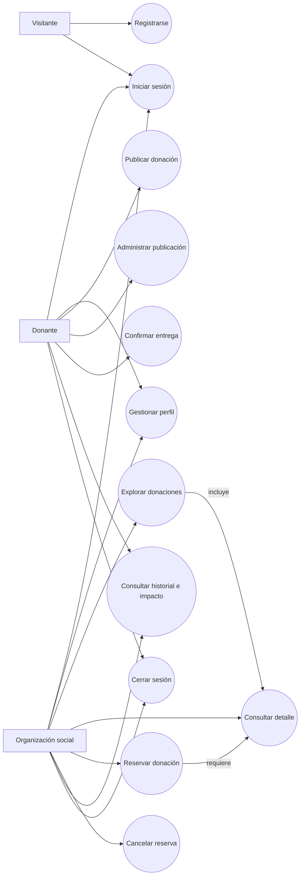
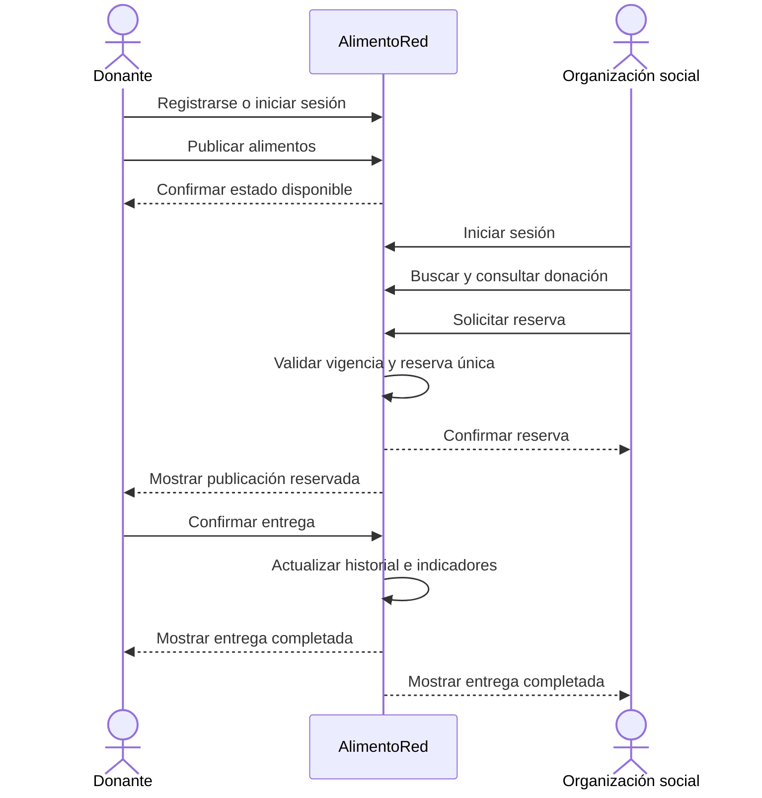
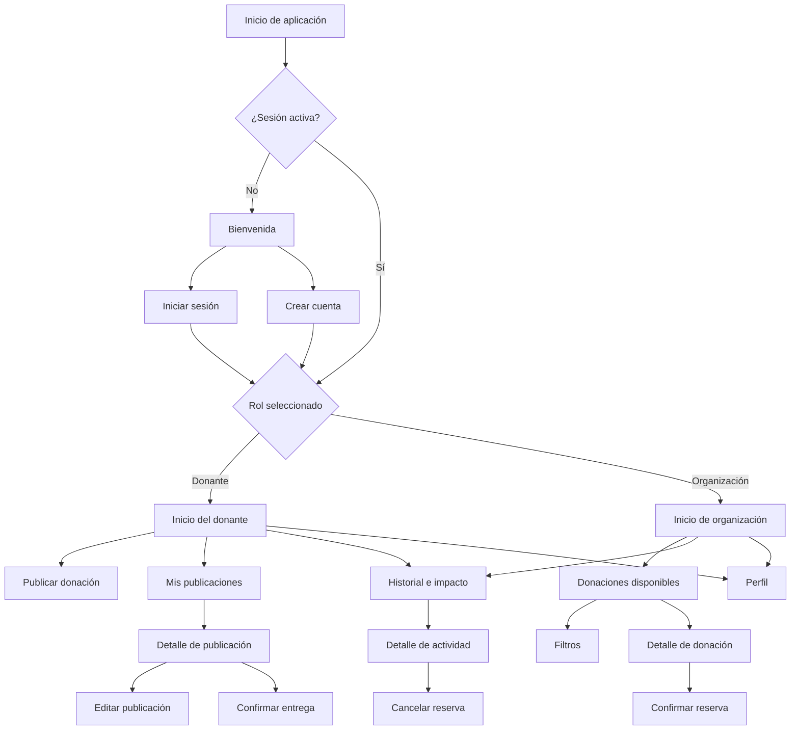

# Fase 4: Historias de usuario, casos de uso y navegación

## Resultado de la fase

AlimentoRed se organizará alrededor de un flujo principal: una persona crea su cuenta, un donante publica alimentos, una organización social encuentra y reserva la publicación, y el donante confirma la entrega. Las historias, casos de uso y navegación descritos aquí derivan de los requisitos aprobados en la Fase 3.

## 1. Convenciones y prioridades

| Elemento | Significado |
|---|---|
| HU | Historia de usuario |
| CU | Caso de uso |
| Must | Obligatorio para demostrar el MVP |
| Should | Importante después del flujo principal |
| Could | Mejora opcional si queda tiempo |

La prioridad no autoriza a omitir validaciones, seguridad o pruebas. Una historia `Must` solo se considera terminada cuando cumple sus criterios de aceptación.

## 2. Mapa de historias

| Etapa | Donante | Organización social |
|---|---|---|
| Acceder | Registrarse e iniciar sesión | Registrarse e iniciar sesión |
| Preparar | Completar perfil | Completar perfil de la organización |
| Ofrecer | Publicar y administrar alimentos | — |
| Explorar | — | Consultar, filtrar y revisar detalles |
| Coordinar | Revisar la reserva | Reservar o cancelar la reserva |
| Completar | Confirmar la entrega | Consultar la entrega confirmada |
| Evaluar | Consultar historial e impacto | Consultar historial e impacto |

## 3. Historias de usuario priorizadas

### HU-01. Registrar una cuenta — Must

**Como** visitante, **quiero** crear una cuenta y elegir mi rol **para** acceder a las funciones que me corresponden.

**Criterios de aceptación:**

- Dado que completo todos los datos válidos, cuando envío el formulario, entonces se crea mi cuenta con un único rol.
- Dado que el correo ya está registrado, cuando intento crear otra cuenta, entonces el sistema rechaza la operación e informa el problema.
- Dado que falta un dato obligatorio o su formato es inválido, cuando intento continuar, entonces se muestran errores junto a los campos correspondientes.

**Trazabilidad:** RF-01; RN-01, RN-04; RNF-03, RNF-05, RNF-06.

### HU-02. Iniciar y cerrar sesión — Must

**Como** usuario registrado, **quiero** iniciar y cerrar sesión **para** usar la aplicación de forma protegida.

**Criterios de aceptación:**

- Las credenciales válidas llevan al inicio correspondiente al rol.
- Las credenciales inválidas generan un mensaje que no revela información sensible.
- Después de cerrar sesión no es posible volver a funciones protegidas sin autenticarse.

**Trazabilidad:** RF-02; RNF-05, RNF-06.

### HU-03. Gestionar el perfil — Must

**Como** usuario autenticado, **quiero** mantener actualizados mis datos **para** que la coordinación use información correcta.

**Criterios de aceptación:**

- El perfil muestra los campos correspondientes al rol.
- Los cambios válidos permanecen después de cerrar y abrir la aplicación.
- El rol no puede modificarse desde el perfil.
- Los campos obligatorios no pueden guardarse vacíos.

**Trazabilidad:** RF-03; RN-01, RN-04; RNF-07, RNF-13.

### HU-04. Publicar una donación — Must

**Como** donante, **quiero** publicar alimentos disponibles **para** que una organización pueda encontrarlos y reservarlos antes de su fecha límite.

**Criterios de aceptación:**

- El formulario solicita título, categoría, descripción, cantidad, unidad, imagen, fecha límite y ubicación referencial.
- La cantidad debe ser mayor que cero y la fecha debe ser futura.
- Una publicación válida se guarda como disponible.
- Un error no crea una publicación parcial ni duplica el envío.

**Trazabilidad:** RF-04; RN-02, RN-05 a RN-07, RN-19; RNF-08 a RNF-10.

### HU-05. Administrar publicaciones propias — Must

**Como** donante, **quiero** consultar, editar o cancelar mis publicaciones **para** mantener la oferta actualizada.

**Criterios de aceptación:**

- Solo se pueden editar los datos esenciales de publicaciones disponibles.
- Cancelar requiere confirmación y conserva el registro en el historial.
- El donante no puede administrar publicaciones ajenas.
- Los estados de las publicaciones se distinguen sin depender únicamente del color.

**Trazabilidad:** RF-05 a RF-07; RN-02, RN-08 a RN-10; RNF-04, RNF-05.

### HU-06. Explorar donaciones disponibles — Must

**Como** organización social, **quiero** consultar y filtrar donaciones vigentes **para** encontrar alimentos adecuados a mis necesidades y ubicación.

**Criterios de aceptación:**

- El listado solo presenta donaciones disponibles y vigentes.
- Se puede buscar por texto y filtrar por categoría y zona declarada.
- Los filtros pueden combinarse y limpiarse.
- Si no hay coincidencias, se muestra un estado vacío comprensible.

**Trazabilidad:** RF-08, RF-09; RN-03, RN-08; RNF-02 a RNF-04.

### HU-07. Consultar el detalle — Must

**Como** organización social, **quiero** revisar la información completa de una donación **para** decidir responsablemente si puedo recogerla.

**Criterios de aceptación:**

- Se muestran imagen, descripción, cantidad, unidad, fecha límite, ubicación, condiciones y estado.
- La acción de reservar solo está disponible para una publicación vigente y disponible.
- Se informa que la aptitud del alimento fue declarada por el donante y no certificada por la aplicación.

**Trazabilidad:** RF-10; RN-19, RN-20; RNF-07.

### HU-08. Reservar una donación — Must

**Como** organización social, **quiero** reservar una donación disponible **para** coordinar su recojo sin competir con reservas duplicadas.

**Criterios de aceptación:**

- La reserva solicita confirmación antes de ejecutarse.
- Una reserva exitosa cambia la publicación a reservada.
- Solo una organización puede mantener la reserva activa.
- Si otra organización se adelantó, se informa la indisponibilidad y se actualiza la vista.

**Trazabilidad:** RF-11; RN-03, RN-11, RN-12; RNF-08, RNF-10.

### HU-09. Cancelar una reserva — Must

**Como** organización social, **quiero** cancelar una reserva que no podré recoger **para** permitir que otra organización aproveche los alimentos.

**Criterios de aceptación:**

- Cancelar requiere confirmación.
- Si la fecha límite sigue vigente, la publicación vuelve a disponible.
- Si la fecha límite pasó, la publicación queda vencida.
- Una entrega confirmada no permite cancelar la reserva.

**Trazabilidad:** RF-12; RN-13 a RN-16.

### HU-10. Confirmar la entrega — Must

**Como** donante, **quiero** confirmar que entregué una donación reservada **para** cerrar el proceso y registrar su impacto.

**Criterios de aceptación:**

- Solo el propietario puede confirmar la entrega.
- Solo una donación reservada puede marcarse como entregada.
- Se muestra que la acción es definitiva antes de confirmarla.
- El resultado aparece en el historial de ambas partes y actualiza sus indicadores.

**Trazabilidad:** RF-13; RN-02, RN-14 a RN-18; RNF-05, RNF-08.

### HU-11. Consultar historial e impacto — Must

**Como** usuario autenticado, **quiero** consultar mi actividad y resultados **para** conocer el estado y aporte de mis donaciones o reservas.

**Criterios de aceptación:**

- La actividad más reciente aparece primero.
- Cada registro muestra su estado actual.
- Solo las entregas confirmadas incrementan los indicadores.
- Las cantidades se agrupan por unidad y no se suman unidades incompatibles.

**Trazabilidad:** RF-14, RF-15; RN-17, RN-18; RNF-13.

### HU-12. Completar la ubicación desde el dispositivo — Should

**Como** donante, **quiero** usar mi ubicación actual **para** reducir el tiempo necesario para completar la dirección de recojo.

**Criterios de aceptación:**

- La aplicación solicita permiso antes de acceder a la ubicación.
- Rechazar el permiso no bloquea la publicación.
- Siempre existe una alternativa de ingreso manual.

**Trazabilidad:** RF-16; RNF-07, RNF-10.

### HU-13. Elegir una imagen desde cámara o galería — Should

**Como** donante, **quiero** tomar o seleccionar una fotografía **para** mostrar el estado visual de los alimentos.

**Criterios de aceptación:**

- Se muestran únicamente las fuentes compatibles con la plataforma.
- Denegar permisos no cierra ni bloquea permanentemente el formulario.
- La imagen seleccionada puede revisarse y reemplazarse antes de publicar.

**Trazabilidad:** RF-17; RNF-01, RNF-10.

## 4. Diagrama general de casos de uso

## 5. Casos de uso detallados

### CU-01. Registrar cuenta

| Campo | Descripción |
|---|---|
| Actor principal | Visitante |
| Precondición | No existe una sesión activa |
| Disparador | Selecciona “Crear cuenta” |
| Postcondición | Cuenta creada con rol donante u organización social |
| Requisitos | RF-01 |

**Flujo principal:**

1. El visitante abre el registro.
2. Selecciona un rol.
3. Completa sus datos y acepta la declaración de uso responsable.
4. El sistema valida los campos.
5. El sistema crea la cuenta.
6. El usuario accede al inicio correspondiente a su rol.

**Flujos alternativos:**

- A1. Datos inválidos: se indican los campos que deben corregirse.
- A2. Correo duplicado: se rechaza el registro y se ofrece iniciar sesión.
- A3. Error de red: no se crea la cuenta y se permite reintentar.

### CU-02. Publicar donación

| Campo | Descripción |
|---|---|
| Actor principal | Donante |
| Precondición | Sesión de donante activa y perfil mínimo completo |
| Disparador | Selecciona “Publicar donación” |
| Postcondición | Publicación disponible y visible para organizaciones |
| Requisitos | RF-04, RF-17 opcional |

**Flujo principal:**

1. El donante abre el formulario.
2. Añade una imagen.
3. Completa descripción, categoría, cantidad y unidad.
4. Indica fecha límite y ubicación de recojo.
5. Revisa la declaración de responsabilidad.
6. Envía el formulario.
7. El sistema valida y guarda la publicación como disponible.
8. Se muestra la publicación creada.

**Flujos alternativos:**

- A1. Fecha o cantidad inválida: no se envía y se muestran correcciones.
- A2. Imagen ausente: se solicita completar el campo.
- A3. Envío en proceso: el botón queda temporalmente deshabilitado.
- A4. Error remoto: se informa el fallo y se permite reintentar sin duplicar.

### CU-03. Buscar y consultar donación

| Campo | Descripción |
|---|---|
| Actor principal | Organización social |
| Precondición | Sesión de organización activa |
| Disparador | Abre el inicio o la sección “Donaciones” |
| Postcondición | Donación seleccionada o filtros conservados durante la consulta |
| Requisitos | RF-08 a RF-10 |

**Flujo principal:**

1. El sistema carga las donaciones disponibles.
2. La organización introduce texto o filtros.
3. El sistema actualiza los resultados.
4. La organización selecciona una publicación.
5. El sistema muestra información completa y estado actual.

**Flujos alternativos:**

- A1. Sin resultados: se muestra un estado vacío y la acción de limpiar filtros.
- A2. Publicación vencida durante la consulta: se actualiza el estado y se oculta la reserva.
- A3. Error de red: se muestra una opción para reintentar.

### CU-04. Reservar donación

| Campo | Descripción |
|---|---|
| Actor principal | Organización social |
| Actor secundario | Donante |
| Precondición | Organización autenticada; publicación disponible y vigente |
| Disparador | Selecciona “Reservar” desde el detalle |
| Postcondición | Reserva activa y publicación reservada |
| Requisitos | RF-11 |

**Flujo principal:**

1. La organización revisa los datos y selecciona reservar.
2. El sistema explica el compromiso de recojo y pide confirmación.
3. La organización confirma.
4. El sistema verifica nuevamente disponibilidad y vigencia.
5. El sistema crea una única reserva y cambia el estado a reservada.
6. Ambas partes pueden ver la reserva en su historial.

**Flujos alternativos:**

- A1. Otra organización reservó primero: se rechaza la operación y se actualiza el detalle.
- A2. La publicación venció: pasa a vencida y no se crea reserva.
- A3. Fallo remoto: el sistema no muestra éxito hasta confirmar la operación.

### CU-05. Cancelar reserva

| Campo | Descripción |
|---|---|
| Actor principal | Organización social |
| Precondición | Existe una reserva activa propia |
| Disparador | Selecciona “Cancelar reserva” |
| Postcondición | Publicación disponible o vencida, según su fecha límite |
| Requisitos | RF-12 |

**Flujo principal:**

1. La organización abre la reserva.
2. Selecciona cancelar.
3. El sistema solicita confirmación.
4. La organización confirma.
5. El sistema cancela la reserva.
6. Si la fecha sigue vigente, la publicación vuelve a disponible.

**Flujo alternativo:**

- A1. Fecha límite superada: la publicación pasa a vencida.
- A2. Entrega ya confirmada: se impide la cancelación y se actualiza la vista.

### CU-06. Confirmar entrega

| Campo | Descripción |
|---|---|
| Actor principal | Donante |
| Actor secundario | Organización social |
| Precondición | Publicación propia en estado reservada |
| Disparador | Selecciona “Confirmar entrega” |
| Postcondición | Donación entregada e indicadores actualizados |
| Requisitos | RF-13, RF-15 |

**Flujo principal:**

1. El donante abre la publicación reservada.
2. Selecciona confirmar entrega.
3. El sistema advierte que la acción será definitiva en el MVP.
4. El donante confirma.
5. El sistema cambia el estado a entregada.
6. El sistema actualiza historiales e indicadores.

**Flujos alternativos:**

- A1. Publicación no reservada: se impide la confirmación.
- A2. Usuario no propietario: se rechaza la operación.
- A3. Fallo remoto: no se altera el estado visible hasta confirmar el guardado.

## 6. Flujo principal de extremo a extremo

## 7. Mapa de navegación

## 8. Estructura de navegación por rol

### Donante

| Sección principal | Propósito | Acciones destacadas |
|---|---|---|
| Inicio | Resumen y acceso rápido | Publicar, ver reservas recientes |
| Mis publicaciones | Administrar oferta | Consultar, editar, cancelar, confirmar entrega |
| Historial | Revisar actividad e impacto | Filtrar por estado, abrir detalle |
| Perfil | Mantener datos | Editar información, cerrar sesión |

### Organización social

| Sección principal | Propósito | Acciones destacadas |
|---|---|---|
| Donaciones | Descubrir alimentos | Buscar, filtrar, abrir detalle, reservar |
| Mis reservas | Coordinar recojos | Consultar estado, cancelar reserva |
| Historial | Revisar actividad e impacto | Abrir entregas y cancelaciones |
| Perfil | Mantener datos | Editar organización, cerrar sesión |

En móvil, estas secciones podrán representarse mediante navegación inferior. En escritorio web, podrán mostrarse en una barra lateral o superior sin cambiar la arquitectura de información.

## 9. Matriz de cobertura

| Historia | Caso de uso | Requisitos cubiertos | Pantalla principal prevista |
|---|---|---|---|
| HU-01 | CU-01 | RF-01 | Registro |
| HU-02 | Acceso transversal | RF-02 | Inicio de sesión |
| HU-03 | Perfil transversal | RF-03 | Perfil |
| HU-04 | CU-02 | RF-04 | Publicar donación |
| HU-05 | Administración | RF-05 a RF-07 | Mis publicaciones y detalle |
| HU-06 | CU-03 | RF-08, RF-09 | Donaciones disponibles |
| HU-07 | CU-03 | RF-10 | Detalle de donación |
| HU-08 | CU-04 | RF-11 | Confirmación de reserva |
| HU-09 | CU-05 | RF-12 | Detalle de reserva |
| HU-10 | CU-06 | RF-13 | Detalle de publicación |
| HU-11 | Consulta transversal | RF-14, RF-15 | Historial e impacto |
| HU-12 | Extensión de CU-02 | RF-16 | Formulario de publicación |
| HU-13 | Extensión de CU-02 | RF-17 | Formulario de publicación |

## 10. Criterios de aceptación de la fase

- [x] Las historias están expresadas desde la necesidad del usuario.
- [x] Cada historia tiene prioridad, criterios y trazabilidad.
- [x] Los casos de uso documentan precondiciones, flujo principal y alternativas.
- [x] El flujo completo conecta donante y organización hasta la entrega.
- [x] El mapa de navegación diferencia ambos roles.
- [x] Todas las pantallas previstas responden a requisitos aprobados.
- [x] Las capacidades P2 no bloquean el flujo principal.

## Siguiente fase

Definir la arquitectura de Flutter, entidades del dominio, modelo de datos, persistencia, permisos y organización del código necesarios para soportar estos flujos.
