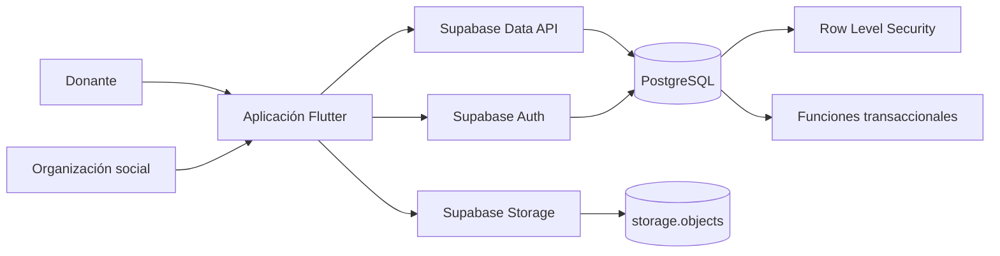
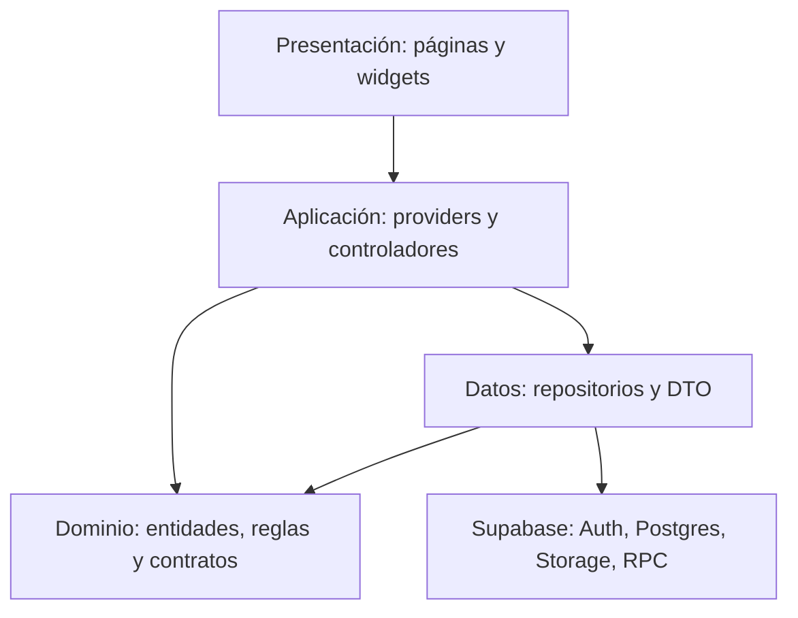
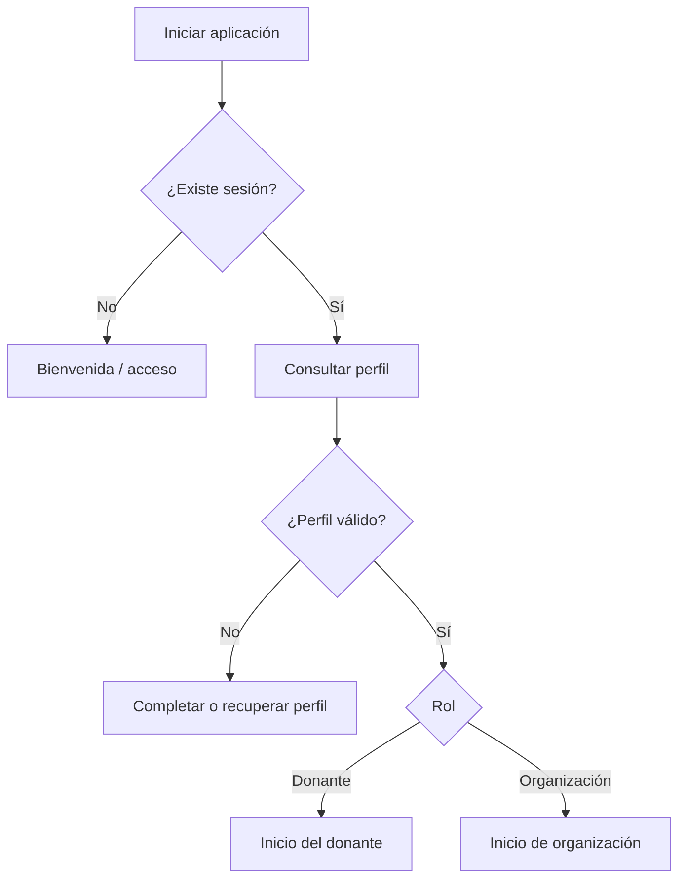
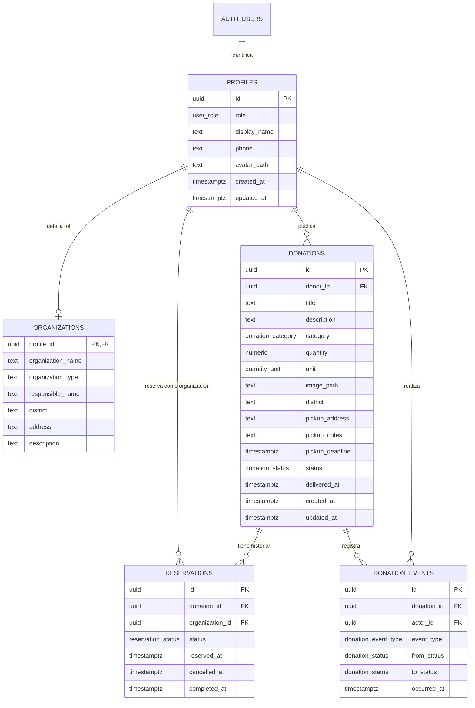

# Fase 5: Arquitectura y modelo de datos

## Resultado de la fase

AlimentoRed utilizará Flutter para Android y web, Supabase como backend y una arquitectura modular por funcionalidades. Supabase proporcionará autenticación, PostgreSQL, almacenamiento de imágenes y políticas de seguridad por fila. Las operaciones críticas de reserva y entrega se ejecutarán dentro de PostgreSQL para evitar duplicidades y manipulaciones desde el cliente.

## 1. Decisiones arquitectónicas

| Área | Decisión | Motivo |
|---|---|---|
| Cliente | Flutter y Dart | Una base de código para Android y web |
| Backend | Supabase | Integra Auth, PostgreSQL, Storage y API para Flutter |
| Base de datos | PostgreSQL administrado por Supabase | Restricciones, transacciones y seguridad por fila |
| Autenticación | Correo y contraseña con Supabase Auth | Cubre el MVP sin construir un servidor de identidad |
| Estado | Riverpod con estados asíncronos | Separa la interfaz de la carga, error y datos |
| Navegación | `go_router` | Rutas declarativas, redirección por sesión y soporte web |
| Organización | Arquitectura feature-first con capas ligeras | Mantiene límites claros sin sobrediseñar un proyecto de dos semanas |
| Imágenes | Supabase Storage en bucket privado | Evita exposición pública innecesaria |
| Tiempo real | No requerido para el MVP | La consistencia crítica se garantiza en base de datos; la interfaz refresca tras mutaciones |
| Operaciones críticas | Funciones PostgreSQL invocadas mediante RPC | Reserva, cancelación y entrega deben ser atómicas |
| Secretos | Variables de compilación para URL y clave pública; nunca `service_role` en Flutter | El cliente solo debe usar credenciales públicas protegidas por RLS |

## 2. Diagrama de contexto



## 3. Arquitectura de la aplicación

La solución aplicará una arquitectura **Clean ligera**, no una reproducción completa de todas las capas de Clean Architecture. El objetivo es separar responsabilidades sin multiplicar archivos innecesarios.



### Presentación

- Páginas y componentes visuales.
- Formularios y validación inmediata.
- Representación de estados de carga, datos, vacío y error.
- Sin consultas directas a Supabase.

### Aplicación

- Controladores o `AsyncNotifier` de Riverpod.
- Coordinación de casos de uso.
- Actualización e invalidación de providers después de una mutación.
- Conversión de errores técnicos a mensajes comprensibles.

### Dominio

- Entidades y enumeraciones.
- Reglas que pueden validarse sin infraestructura.
- Contratos de repositorio.
- Errores conocidos de negocio.

### Datos

- Implementaciones de repositorios con Supabase.
- Conversión entre filas JSON y entidades.
- Carga y obtención protegida de imágenes.
- Invocación de funciones RPC para operaciones atómicas.

## 4. Organización propuesta del código

```text
lib/
├── app/
│   ├── app.dart
│   ├── bootstrap.dart
│   ├── router.dart
│   └── theme/
├── core/
│   ├── config/
│   ├── errors/
│   ├── presentation/
│   ├── utils/
│   └── validation/
├── features/
│   ├── auth/
│   │   ├── data/
│   │   ├── domain/
│   │   └── presentation/
│   ├── profile/
│   ├── donations/
│   ├── reservations/
│   └── impact/
└── main.dart

supabase/
├── migrations/
├── seed.sql
└── tests/

test/
├── core/
├── features/
└── helpers/
```

Cada funcionalidad contendrá únicamente las capas que necesite. Un componente no se vuelve “arquitectónico” por estar dividido en muchos archivos.

## 5. Dependencias previstas

| Paquete | Responsabilidad | Prioridad |
|---|---|---|
| `supabase_flutter` | Auth, base de datos, Storage y RPC | Obligatorio |
| `flutter_riverpod` | Estado asíncrono e inyección de dependencias | Obligatorio |
| `go_router` | Navegación y redirecciones por sesión/rol | Obligatorio |
| `image_picker` | Cámara o galería en plataformas compatibles | Condicionado |
| `geolocator` | Ubicación actual con permiso | Condicionado |
| `intl` | Formatos de fecha y texto | Obligatorio |

Las versiones exactas se fijarán al crear el proyecto usando versiones compatibles con el Flutter instalado. No se copiarán números de versión sin comprobarlos con `flutter pub`.

## 6. Flujo de autenticación y navegación

1. Flutter inicializa Supabase antes de construir la aplicación.
2. El enrutador observa el estado de autenticación.
3. Sin sesión, las rutas protegidas redirigen al inicio de sesión.
4. Con sesión, se consulta el perfil asociado a `auth.users.id`.
5. El rol determina el inicio y las rutas permitidas.
6. Si falta el perfil, se presenta una recuperación controlada y no se asume un rol.
7. Al cerrar sesión se invalidan providers con datos del usuario anterior.



Supabase persiste la sesión del cliente. En Android se podrá usar almacenamiento seguro para reforzar el manejo local. En web, la seguridad real dependerá de tokens de sesión limitados y de RLS, no de esconder datos en el navegador.

## 7. Entidades del dominio

### Perfil

| Campo | Tipo | Regla |
|---|---|---|
| id | UUID | Igual al identificador de Supabase Auth |
| role | `donor` o `organization` | Inmutable durante el MVP |
| displayName | texto | Obligatorio |
| phone | texto | Obligatorio |
| avatarPath | texto opcional | Ruta en Storage, no URL permanente |
| createdAt | fecha/hora | Generada por servidor |
| updatedAt | fecha/hora | Generada por servidor |

### Organización

| Campo | Tipo | Regla |
|---|---|---|
| profileId | UUID | Clave primaria y referencia al perfil |
| organizationName | texto | Obligatorio |
| organizationType | texto | Comedor, olla común, albergue u otro |
| responsibleName | texto | Obligatorio |
| district | texto | Obligatorio |
| address | texto | Obligatorio |
| description | texto | Obligatorio |

### Donación

| Campo | Tipo | Regla |
|---|---|---|
| id | UUID | Generado por servidor |
| donorId | UUID | Propietario autenticado |
| title | texto | Obligatorio |
| description | texto | Obligatorio |
| category | enum | Categoría admitida |
| quantity | decimal | Mayor que cero |
| unit | enum | kg, unidades, litros o porciones |
| imagePath | texto | Ruta privada de Storage |
| district | texto | Obligatorio |
| pickupAddress | texto | Visible según política de acceso |
| pickupNotes | texto opcional | Condiciones de recojo |
| pickupDeadline | fecha/hora | Futura al publicar |
| status | enum | Estado controlado |
| createdAt | fecha/hora | Generada por servidor |
| updatedAt | fecha/hora | Generada por servidor |
| deliveredAt | fecha/hora opcional | Solo cuando se confirma entrega |

### Reserva

| Campo | Tipo | Regla |
|---|---|---|
| id | UUID | Generado por servidor |
| donationId | UUID | Donación reservada |
| organizationId | UUID | Perfil con rol organización |
| status | `active`, `cancelled` o `completed` | Estado controlado |
| reservedAt | fecha/hora | Generada por servidor |
| cancelledAt | fecha/hora opcional | Solo al cancelar |
| completedAt | fecha/hora opcional | Solo al entregar |

### Evento de donación

| Campo | Tipo | Regla |
|---|---|---|
| id | entero o UUID | Generado por servidor |
| donationId | UUID | Donación afectada |
| actorId | UUID | Usuario que causó la acción |
| eventType | enum | published, edited, reserved, reservation_cancelled, cancelled, delivered, expired |
| fromStatus | enum opcional | Estado anterior |
| toStatus | enum | Estado resultante |
| occurredAt | fecha/hora | Generada por servidor |

## 8. Modelo relacional



## 9. Enumeraciones y restricciones

### Roles

```text
donor | organization
```

### Estados de donación

```text
available | reserved | delivered | cancelled | expired
```

### Unidades

```text
kg | units | liters | portions
```

### Categorías iniciales

```text
fruits_vegetables | grains | bakery | dairy | prepared_food | canned_packaged | other
```

### Restricciones obligatorias en PostgreSQL

- `quantity > 0`.
- Campos de texto obligatorios no vacíos después de eliminar espacios.
- Referencias con eliminación restringida cuando exista historial.
- Un perfil de organización debe referenciar una cuenta con rol `organization`.
- Una donación debe pertenecer a una cuenta con rol `donor`.
- Solo una reserva activa por donación mediante índice único parcial.
- Estados y marcas de tiempo deben permanecer consistentes.

La validación de Flutter mejora la experiencia; las restricciones de PostgreSQL protegen los datos incluso si otro cliente intenta omitirla.

## 10. Operaciones transaccionales

### Reservar donación

La aplicación no realizará un `insert` directo como operación principal. Invocará `reserve_donation(donation_id)` mediante RPC.

La función deberá:

1. Identificar al usuario con `auth.uid()`.
2. Confirmar que su perfil tiene rol organización.
3. Actualizar la donación solo si está disponible y vigente.
4. Crear la reserva activa.
5. Registrar el evento.
6. Confirmar toda la operación o deshacerla por completo.

Se combinarán una actualización condicional y un índice único parcial. Así, dos solicitudes concurrentes no pueden reservar la misma donación.

### Cancelar reserva

`cancel_reservation(reservation_id)` comprobará propiedad y estado. Cancelará la reserva y devolverá la donación a disponible si sigue vigente; de lo contrario, la marcará vencida.

### Confirmar entrega

`confirm_delivery(donation_id)` comprobará que el usuario sea el donante propietario y que exista una reserva activa. Luego marcará donación y reserva como completadas, registrará fecha y evento.

### Cancelar publicación

`cancel_donation(donation_id)` comprobará propiedad y estado, cancelará una reserva activa si existe y registrará el evento sin eliminar datos.

### Marcar vencimientos

El listado siempre excluirá donaciones cuya fecha límite ya pasó, aunque su estado aún no haya sido materializado. Una función `expire_donations()` sincronizará esos estados al abrir o refrescar listados. En una versión productiva se programaría su ejecución periódica en el servidor.

## 11. Seguridad por fila

Todas las tablas públicas tendrán RLS habilitado. La clave pública de Supabase no concede acceso por sí sola; cada operación debe cumplir una política.

| Recurso | Lectura | Inserción | Actualización | Eliminación |
|---|---|---|---|---|
| profiles | Propio; datos públicos mínimos de participantes autenticados | Solo perfil con `id = auth.uid()` | Solo propio; rol protegido | No permitida desde cliente |
| organizations | Propio y datos públicos mínimos necesarios para participantes | Solo organización propietaria | Solo propietaria | No permitida |
| donations | Disponibles para organizaciones; propias o relacionadas para participantes | Solo donante propietario | Directa limitada al propietario y estado disponible | No permitida |
| reservations | Solo donante de la publicación y organización propietaria | Mediante RPC | Mediante RPC | No permitida |
| donation_events | Solo participantes de la donación | Mediante funciones del servidor | No permitida | No permitida |

### Principios de políticas

- Comparar propietario con `(select auth.uid())`.
- Asignar políticas al rol `authenticated`.
- No confiar en el rol enviado desde Flutter.
- Comprobar el rol almacenado en `profiles` dentro de políticas o funciones.
- Revocar ejecución pública de funciones críticas y concederla solo a `authenticated`.
- Fijar `search_path` en funciones de seguridad definida para reducir riesgos.
- Nunca incluir la clave `service_role` en Android, web ni el repositorio.

## 12. Almacenamiento de imágenes

Se creará un bucket privado `donation-images`.

### Convención de rutas

```text
<user-id>/<donation-id>/<generated-file-name>
```

### Políticas

- Un donante autenticado puede subir archivos únicamente dentro de su carpeta `<auth.uid()>`.
- Solo el propietario puede reemplazar o eliminar una imagen mientras la publicación sea editable.
- Usuarios autenticados autorizados pueden leer imágenes vinculadas con donaciones visibles para ellos.
- Se limitarán tipo y tamaño antes de subir; inicialmente JPEG, PNG o WebP y un máximo definido durante implementación.
- La base guardará `image_path`, no una URL firmada con vencimiento.

La interfaz obtendrá una URL firmada temporal o descargará el archivo mediante una sesión autorizada. Esto evita convertir todas las fotografías y ubicaciones en contenido público.

## 13. Repositorios de la aplicación

| Contrato | Responsabilidad |
|---|---|
| `AuthRepository` | Registro, acceso, sesión y cierre de sesión |
| `ProfileRepository` | Perfil y datos de organización |
| `DonationRepository` | CRUD permitido, listado, filtros y detalle |
| `ReservationRepository` | Reservar y cancelar mediante RPC |
| `ImpactRepository` | Historial e indicadores derivados |
| `ImageRepository` | Carga y acceso temporal a imágenes |

Los repositorios devolverán entidades de dominio o errores tipados. La presentación no interpretará códigos internos de PostgreSQL ni excepciones crudas de Supabase.

## 14. Estrategia de estado con Riverpod

- Providers de infraestructura expondrán el cliente Supabase y los repositorios.
- Providers de consulta manejarán listados, detalle, perfil e indicadores.
- `AsyncNotifier` manejará formularios y mutaciones con estados de carga y error.
- Después de publicar, reservar, cancelar o entregar se invalidarán únicamente los providers afectados.
- Los widgets representarán explícitamente carga, error, vacío y datos.
- En pruebas, los repositorios serán reemplazados por implementaciones falsas.

No se almacenará una segunda copia global de toda la base de datos dentro de Flutter. Supabase será la fuente persistente y Riverpod administrará el estado necesario para cada pantalla.

## 15. Configuración y ambientes

Flutter recibirá únicamente:

```text
SUPABASE_URL
SUPABASE_ANON_KEY
```

Estas variables se suministrarán mediante configuración de compilación y no se escribirán directamente en archivos versionados. La clave pública puede aparecer técnicamente en el cliente compilado; por eso toda la protección depende de RLS y no de considerarla secreta.

Para la presentación se usará un proyecto Supabase de demostración con datos controlados. Antes de una operación real deberán separarse ambientes de desarrollo y producción, activar confirmación de correo y revisar políticas con usuarios reales.

## 16. Estrategia de pruebas

### Flutter

- Pruebas unitarias de validadores, estados y mapeos.
- Pruebas de repositorios con cliente o adaptador simulado.
- Pruebas de widgets para formularios, carga, error y permisos visuales.
- Pruebas de integración del flujo principal.

### Supabase/PostgreSQL

- Pruebas SQL de restricciones y transiciones.
- Pruebas de RLS con donante, organización y usuario no relacionado.
- Prueba concurrente de doble reserva.
- Pruebas de RPC para cancelar, entregar y vencer.
- Pruebas de políticas del bucket privado.

## 17. Trazabilidad arquitectónica

| Necesidad | Decisión arquitectónica |
|---|---|
| Persistencia entre plataformas | PostgreSQL mediante Supabase |
| Sesión y roles | Supabase Auth + profiles + redirección en `go_router` |
| Evitar doble reserva | RPC transaccional + índice único parcial |
| Proteger datos | RLS en todas las tablas públicas |
| Proteger imágenes | Bucket privado + rutas por propietario |
| Mantener interfaz reactiva | Riverpod con estados asíncronos |
| Historial verificable | donation_events y registros no eliminados |
| Indicadores consistentes | Consultas sobre donaciones entregadas |
| Android y web | Flutter con adaptaciones de presentación |

## 18. Decisiones aplazadas

- Realtime no se activará salvo evidencia de que el refresco explícito resulta insuficiente.
- Geolocalización y mapas siguen condicionados al avance del MVP.
- Notificaciones remotas requerirían un servicio adicional y quedan fuera.
- Verificación documental de organizaciones queda para una versión posterior.
- La automatización periódica de vencimientos se endurecerá para producción.

## 19. Criterios de aceptación de la fase

- [x] La arquitectura separa interfaz, aplicación, dominio y datos.
- [x] La organización de carpetas y responsabilidades está definida.
- [x] Las entidades y relaciones cubren los requisitos P1.
- [x] Supabase Auth, PostgreSQL y Storage tienen responsabilidades delimitadas.
- [x] La reserva única cuenta con una estrategia transaccional.
- [x] Las políticas RLS se diseñaron por recurso y actor.
- [x] Las imágenes no dependen de exposición pública.
- [x] La configuración no requiere credenciales privilegiadas en Flutter.
- [x] Existe una estrategia de pruebas para cliente y backend.

## Fuentes técnicas

- Supabase Flutter: <https://github.com/supabase/supabase-flutter>
- Supabase Auth para Flutter: <https://supabase.com/docs/reference/dart/auth-signup>
- Seguridad por filas de Supabase: <https://supabase.com/docs/guides/database/postgres/row-level-security>
- Control de acceso de Supabase Storage: <https://supabase.com/docs/guides/storage/security/access-control>
- Riverpod: <https://riverpod.dev/docs/introduction/getting_started>
- `go_router`: <https://pub.dev/packages/go_router>

## Siguiente fase

Crear wireframes y mockups basados en el mapa de navegación, las historias de usuario y los estados visuales de carga, error, vacío, éxito y permisos.
